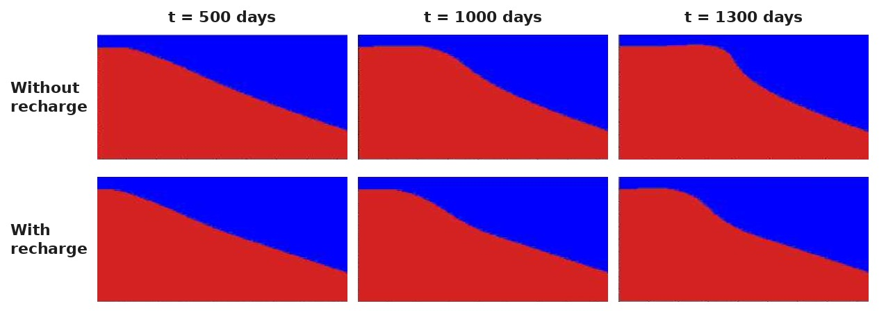

# Influence of Permeability Anisotropy on the Advance of the Freshwater–Saltwater Interface

**Master's thesis in Mechanics and Energetics** (major: Fluid and Interactive Phenomena)
Université Félix Houphouët-Boigny (UFHB), Abidjan, Côte d'Ivoire · Defended on 14 January 2021
**Author:** Regis Konan Marcel Djaha · **Supervisor:** Prof. Kablan Jérôme Adou

📄 **Full thesis (in French):** [Memoire_Djaha_Regis.pdf](Memoire_Djaha_Regis.pdf), *Influence de l'anisotropie en perméabilité du milieu sur l'avancée de l'interface eau douce–eau salée*
🌐 [Project page](https://regiskonan.github.io/projects/fluid-mechanics/)

  
   <em>FreeFem++ simulation of the salt wedge under pumping (red: salt water, blue: fresh water).</em>

## Motivation

Fresh water makes up less than 3% of the water on Earth, and much of it is stored underground. In coastal aquifers, pumping fresh groundwater lets salt water move inland, forming a **salt wedge** that can make the aquifer unusable for drinking water.

Classical results assume an **isotropic** aquifer, with the same permeability in every direction. This thesis studies the advance of the freshwater–saltwater interface when the medium is **anisotropic**.

## Model

Groundwater flow in a vertical 2D section $(x, z)$ of an unconfined aquifer follows a storage equation coupled with Darcy's law:

$$
S\,\frac{\partial h}{\partial t} + \operatorname{div}(\mathbf{U}) = Q^A - Q^P,
\qquad
\mathbf{U} = -\mathbf{K}\,\nabla h
$$

where $h$ is the hydraulic head, $S$ the storage coefficient, and $Q^A$ and $Q^P$ the recharge and pumping rates. Transmission conditions are imposed at the interface between fresh and salt water.

Anisotropy enters through the hydraulic conductivity tensor, with horizontal conductivity larger than vertical conductivity:

$$
\mathbf{K} = \begin{pmatrix} K_{xx} & 0 \\ 0 & K_{zz} \end{pmatrix}, \qquad K_{xx} = 10\,K_{zz}
$$

## Numerical method

- **Finite element method** with [FreeFem++](https://freefem.org/)
- Rectangular unconfined aquifer of **4 m × 2 m**
- Simulation over **1,300 days**, in two scenarios: **pumping without recharge** and **pumping with recharge**

## Results

| | Without recharge | With recharge |
|---|---|---|
| Days 500–700 | Strong advance of the salt wedge, which loses its oblique shape | Slower advance |
| Saltwater cone (*upconing*) appears | **Day 1,000** | **Day 1,300** (about 300 days later) |
| Day 1,300 | Cone approaches the critical point beyond which the aquifer becomes unusable | Cone just starting |

**Conclusion:** recharge (e.g. from rainfall) delays saltwater intrusion, but on its own it is only marginally sufficient to limit the risk under excessive pumping. Reducing pressure on aquifers and raising awareness of water use remain necessary.

## Thesis outline

1. **Flow in porous media:** porosity, storage coefficient, hydraulic conductivity tensor, Darcy's law, continuity equation, and a review of salt wedge results in the isotropic case
2. **Salt wedge advance in the anisotropic case:** numerical simulations and interpretation

## Coursework (UFHB)

- **First year:** Mathematical methods · Solid mechanics · Constitutive laws and thermodynamics of continuous media · Energetics and transfers · Object-oriented programming · Scientific programming · Viscous fluid mechanics · Modelling and numerical simulation (R, Scilab) · Numerical analysis of PDEs · Aerodynamics · Hydraulics and pipe flow · Complex media
- **Second year:** Finite volume methods · Turbulence modelling · Instability and chaos · Convective transfer · Environmental flow dynamics · Atmospheric processes · Ocean–atmosphere interaction · Fluid mechanics seminar
